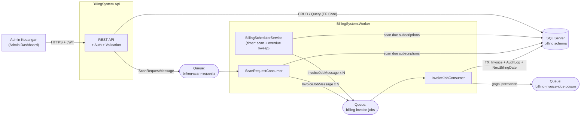
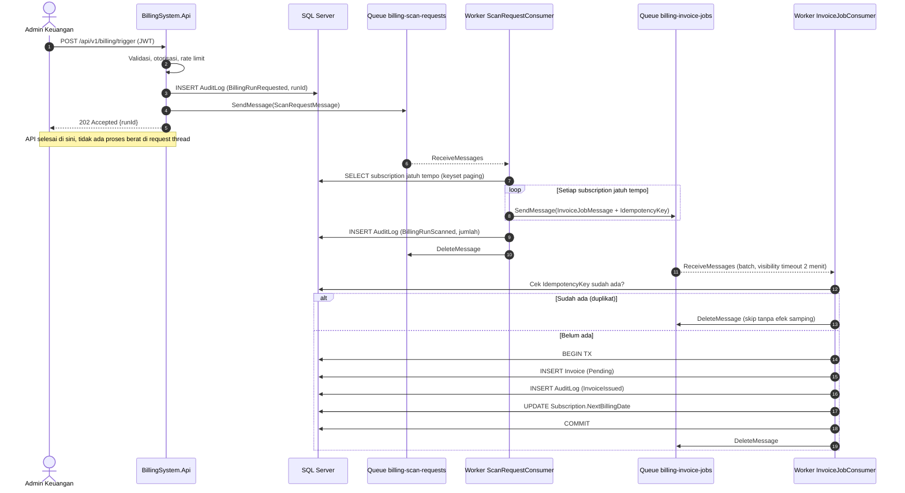
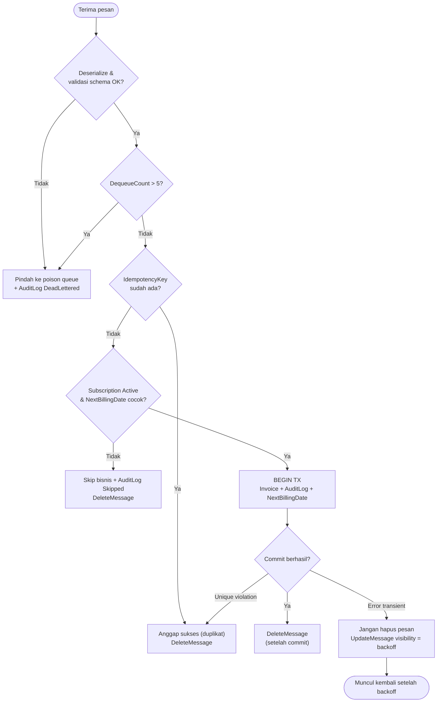
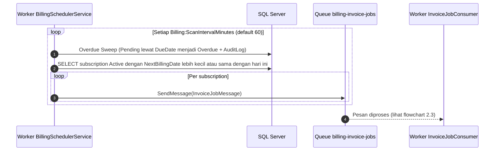
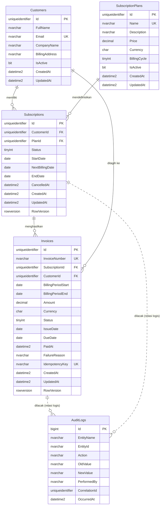

# Architecture Document

# Automated Billing System — Arsitektur Sistem & Data

| Atribut | Nilai |
|---|---|
| **Versi dokumen** | 1.0 |
| **Tanggal** | 19 Oktober 2026 |
| **Dokumen terkait** | [PRD.md](./PRD.md) · [Rules.md](./Rules.md) · [Design_system.md](./Design_system.md) |

---

## Daftar Isi

1. [System Overview & Tech Stack](#1-system-overview--tech-stack)
2. [High-Level Architecture](#2-high-level-architecture)
3. [Struktur Solution & Layering](#3-struktur-solution--layering)
4. [Component Breakdown](#4-component-breakdown)
5. [Database Design (ERD & Spesifikasi Tabel)](#5-database-design-erd--spesifikasi-tabel)
6. [Asynchronous Queue Workflow](#6-asynchronous-queue-workflow)
7. [Konsistensi, Idempotency & Error Handling](#7-konsistensi-idempotency--error-handling)
8. [Cross-Cutting Concerns](#8-cross-cutting-concerns)
9. [Deployment & Environment Lokal](#9-deployment--environment-lokal)
10. [Architecture Decision Records (ADR)](#10-architecture-decision-records-adr)

---

## 1. System Overview & Tech Stack

**Automated Billing System** terdiri dari dua proses terpisah yang berbagi *database* dan *queue*:

- **BillingSystem.Api** — Web API yang melayani Admin Dashboard (CRUD, query, trigger).
- **BillingSystem.Worker** — Worker Service (`BackgroundService`) yang menjalankan penjadwalan penagihan dan memproses pesan antrean.

Keduanya berbagi *library* `Domain`, `Application`, dan `Infrastructure`, sehingga aturan bisnis tidak terduplikasi.

### 1.1 Tech Stack Breakdown

| Lapisan | Teknologi | Peran |
|---|---|---|
| Runtime & bahasa | **.NET 8 (LTS)**, **C# 12** | Platform utama; *nullable reference types* aktif |
| Web API | **ASP.NET Core 8** (Controllers/Minimal API) | REST endpoint, pipeline middleware, auth |
| Background processing | **.NET Worker Service** (`Microsoft.NET.Sdk.Worker`, `BackgroundService`) | Scheduler + queue consumer |
| ORM | **Entity Framework Core 8** | Akses data, migrasi, concurrency token |
| Database | **SQL Server 2022** | Penyimpanan relasional, unique index, `SEQUENCE` |
| Messaging | **Azure Storage Queue** (dev: **Azurite**) via `Azure.Storage.Queues` | Antrean asinkron at-least-once |
| Validasi | **FluentValidation** | Validasi request & message |
| Logging | **Serilog** (+ OpenTelemetry opsional) | Log terstruktur + `CorrelationId` |
| Auth | **JWT Bearer**, role `FinanceAdmin`, `ReadOnlyAuditor` | Otentikasi & otorisasi |
| Dokumentasi API | **Swashbuckle / OpenAPI** | Swagger UI |
| Testing | **xUnit**, **FluentAssertions**, **Testcontainers** (SQL Server), Azurite | Unit & integration test |
| Container | **Docker Compose** | Environment lokal (SQL Server + Azurite) |

> **Catatan:** Azure Storage Queue dipilih untuk MVP karena sederhana, murah, dan semantiknya (visibility timeout, `DequeueCount`) sudah cukup. Perbandingan dengan Azure Service Bus ada di [ADR-002](#adr-002--azure-storage-queue-dibanding-service-bus).

---

## 2. High-Level Architecture

### 2.1 Diagram Komponen



### 2.2 Sequence Diagram — Trigger Manual (End-to-End)



### 2.3 Flowchart — Pemrosesan `InvoiceJobMessage`



### 2.4 Sequence Diagram — Penagihan Terjadwal



---

## 3. Struktur Solution & Layering

```
AutomatedBillingSystem/
├── src/
│   ├── BillingSystem.Domain/            # Entity, enum, state machine, domain rules (tanpa dependensi eksternal)
│   ├── BillingSystem.Application/       # Use case/service, DTO, validator, abstraksi (IClock, IQueuePublisher, IPaymentGateway), message contract
│   ├── BillingSystem.Infrastructure/    # EF Core DbContext, konfigurasi entity, migrasi, QueueClient wrapper, repository
│   ├── BillingSystem.Api/               # ASP.NET Core Web API
│   └── BillingSystem.Worker/            # Worker Service (hosted services)
├── tests/
│   ├── BillingSystem.Domain.Tests/
│   ├── BillingSystem.Application.Tests/
│   └── BillingSystem.IntegrationTests/  # Testcontainers (SQL Server) + Azurite
├── docs/                                # PRD.md, Architecture.md, Rules.md, Design_system.md
├── docker-compose.yml
├── Directory.Build.props                # Nullable, analyzers, TreatWarningsAsErrors
├── .editorconfig
└── BillingSystem.sln
```

**Aturan ketergantungan (Dependency Rule):**

```
Api ─────────┐
             ├──► Application ──► Domain
Worker ──────┤          ▲
             │          │ (implementasi abstraksi)
             └──► Infrastructure
```

- `Domain` tidak bergantung pada siapa pun.
- `Application` hanya bergantung pada `Domain`; mendefinisikan *interface* yang diimplementasi `Infrastructure`.
- `Api` dan `Worker` adalah *composition root* (mendaftarkan DI), tidak memuat logika bisnis.

---

## 4. Component Breakdown

### 4.1 BillingSystem.Api — REST API & Request Pipeline

**Tanggung jawab:** autentikasi/otorisasi, validasi, CRUD, query pelaporan, dan **menerima** permintaan billing (bukan memprosesnya).

#### 4.1.1 Request Pipeline (urutan middleware)

```
Request
  → ForwardedHeaders / HTTPS Redirection
  → Serilog Request Logging
  → CorrelationIdMiddleware          (baca/buat X-Correlation-Id)
  → ExceptionHandler (ProblemDetails RFC 7807)
  → CORS
  → Authentication (JWT)
  → Authorization (policy FinanceAdmin / ReadOnlyAuditor)
  → RateLimiter (policy "billing-trigger": 1 req/menit/user)
  → Endpoint (FluentValidation → Application service)
Response
```

#### 4.1.2 Daftar Endpoint (`/api/v1`)

| Grup | Method & Path | Deskripsi | Role | Sukses |
|---|---|---|---|---|
| Customers | `POST /customers` | Buat customer | FinanceAdmin | 201 |
| | `GET /customers`, `GET /customers/{id}` | List (search, paging) / detail | Semua | 200 |
| | `PUT /customers/{id}` | Ubah customer | FinanceAdmin | 200 |
| | `DELETE /customers/{id}` | Nonaktifkan (soft) | FinanceAdmin | 204 |
| Plans | `POST /plans`, `PUT /plans/{id}` | Buat / ubah plan | FinanceAdmin | 201 / 200 |
| | `GET /plans`, `GET /plans/{id}` | List / detail | Semua | 200 |
| | `DELETE /plans/{id}` | Nonaktifkan plan | FinanceAdmin | 204 |
| Subscriptions | `POST /subscriptions` | Buat langganan | FinanceAdmin | 201 |
| | `GET /subscriptions`, `GET /subscriptions/{id}` | List / detail | Semua | 200 |
| | `POST /subscriptions/{id}/pause` · `/resume` · `/cancel` | Siklus hidup | FinanceAdmin | 200 |
| Invoices | `GET /invoices` | List: `status`, `search`, `sortBy`, `sortDir`, `page`, `pageSize` | Semua | 200 |
| | `GET /invoices/{id}` | Detail + riwayat audit ringkas | Semua | 200 |
| | `PATCH /invoices/{id}/status` | Ubah status (state machine) | FinanceAdmin | 200 / 409 |
| Billing | `POST /billing/trigger` | Picu job penagihan manual | FinanceAdmin | **202** |
| Dashboard | `GET /dashboard/summary` | Total revenue, pending invoices, active subscriptions | Semua | 200 |
| Audit | `GET /audit-logs` | Filter `entityName`, `entityId`, `action`, `from`, `to` | Semua | 200 |
| Health | `GET /health/live`, `/health/ready` | Liveness & readiness | Anonim | 200 / 503 |

**Contoh kontrak — trigger manual**

```http
POST /api/v1/billing/trigger
Authorization: Bearer <jwt>
Content-Type: application/json

{ "asOfDate": "2026-11-01" }      // opsional, hanya bila Billing:AllowSimulatedDate = true
```
```http
HTTP/1.1 202 Accepted
Location: /api/v1/audit-logs?entityName=BillingRun&entityId=0b6f...
Content-Type: application/json

{ "runId": "0b6f2c1e-5a3b-4c7e-9d5a-1f0c2b8a7e11", "status": "Accepted", "requestedAt": "2026-10-19T03:15:00Z" }
```

**Contoh kontrak — ringkasan dashboard**

```json
{
  "totalRevenue":        { "amount": 125000000.00, "currency": "IDR", "periodLabel": "Bulan ini", "deltaPercent": 12.4 },
  "pendingInvoices":     { "count": 18, "outstandingAmount": 27000000.00, "currency": "IDR" },
  "activeSubscriptions": { "count": 342 },
  "meta":                { "generatedAt": "2026-10-19T03:15:00Z", "simulationEnabled": true }
}
```

**Contoh respons error (ProblemDetails)**

```json
{
  "type": "https://billing.local/problems/invalid-status-transition",
  "title": "Transisi status tidak valid",
  "status": 409,
  "detail": "Invoice INV-202610-000123 tidak dapat berpindah dari Paid ke Overdue.",
  "traceId": "00-4bf92f35...-01",
  "correlationId": "c3d1b9e2-..."
}
```

#### 4.1.3 Prinsip Desain API

- **Thin controllers**: hanya *binding → validate → call service → map response*.
- **Pagination** sisi server dengan *envelope* `{ items, page, pageSize, totalCount }` dan *ordering* deterministik (tie-breaker `Id`).
- **Trigger bersifat asinkron murni**: tidak ada query berat; hanya *audit insert* dan *enqueue*.
- **Kegagalan enqueue** → `AuditLog BillingRunEnqueueFailed` + `503 Service Unavailable`.

---

### 4.2 BillingSystem.Worker — Background Processor & Event Queue Consumer

Worker menjalankan tiga `BackgroundService`:

| Hosted Service | Fungsi | Pemicu |
|---|---|---|
| **BillingSchedulerService** | (1) *Overdue sweep*: `Pending`→`Overdue`, `Overdue` > grace → `Failed`. (2) Memindai langganan jatuh tempo → enqueue `InvoiceJobMessage`. | `PeriodicTimer` (`Billing:ScanIntervalMinutes`) |
| **ScanRequestConsumer** | Mengonsumsi `ScanRequestMessage` dari `billing-scan-requests` (pemicu manual), menjalankan pemindaian yang sama dengan scheduler. | Pesan queue |
| **InvoiceJobConsumer** | Mengonsumsi `InvoiceJobMessage`, menerbitkan Invoice secara idempoten dan atomik. | Pesan queue |

**Pola konsumsi (pseudo-code):**

```csharp
while (!stoppingToken.IsCancellationRequested)
{
    var response = await queue.ReceiveMessagesAsync(
        maxMessages: 16, visibilityTimeout: TimeSpan.FromMinutes(2), stoppingToken);

    if (response.Value.Length == 0)
    {
        await Task.Delay(TimeSpan.FromSeconds(2), stoppingToken); // idle backoff
        continue;
    }

    await Parallel.ForEachAsync(response.Value,
        new ParallelOptions { MaxDegreeOfParallelism = options.MaxConcurrency, CancellationToken = stoppingToken },
        async (msg, ct) => await handler.HandleAsync(msg, ct)); // handler memutuskan delete / retry / poison
}
```

**Karakteristik Worker:**

- **Stateless** → dapat di-*scale out* horizontal.
- **Graceful shutdown**: menghormati `stoppingToken`; pesan yang belum selesai otomatis terlihat kembali setelah visibility timeout.
- **Scope per pesan**: setiap pesan diproses dalam `IServiceScope` sendiri (DbContext tidak dibagi antar pesan).
- **Konfigurasi** via Options pattern:

```json
{
  "Billing": {
    "BusinessTimeZone": "Asia/Jakarta",
    "ScanIntervalMinutes": 60,
    "PaymentTermDays": 14,
    "OverdueGraceDays": 30,
    "AllowSimulatedDate": true
  },
  "Queues": {
    "ScanRequests": "billing-scan-requests",
    "InvoiceJobs": "billing-invoice-jobs",
    "InvoiceJobsPoison": "billing-invoice-jobs-poison",
    "MaxDequeueCount": 5,
    "MaxConcurrency": 8,
    "VisibilityTimeoutSeconds": 120,
    "MessageTtlDays": 7
  }
}
```

---

## 5. Database Design (ERD & Spesifikasi Tabel)

Semua tabel berada pada schema **`billing`**. Konvensi: PK `uniqueidentifier` (GUID sekuensial, `NEWSEQUENTIALID()`/`Guid.CreateVersion7()`), kecuali `AuditLogs` yang memakai `bigint IDENTITY` untuk urutan dan performa append. Nilai uang `decimal(18,2)`. Timestamp `datetime2(3)` dalam **UTC**; tanggal bisnis memakai tipe `date`.

### 5.1 Entity Relationship Diagram



### 5.2 Tabel `billing.Customers`

| Kolom | Tipe | Constraint | Keterangan |
|---|---|---|---|
| `Id` | `uniqueidentifier` | PK | |
| `FullName` | `nvarchar(200)` | NOT NULL | |
| `Email` | `nvarchar(256)` | NOT NULL, **UNIQUE** | Disimpan *lowercase* |
| `CompanyName` | `nvarchar(200)` | NULL | |
| `BillingAddress` | `nvarchar(500)` | NULL | |
| `IsActive` | `bit` | NOT NULL, default 1 | Soft delete |
| `CreatedAt` / `UpdatedAt` | `datetime2(3)` | NOT NULL | UTC |

### 5.3 Tabel `billing.SubscriptionPlans`

| Kolom | Tipe | Constraint | Keterangan |
|---|---|---|---|
| `Id` | `uniqueidentifier` | PK | |
| `Name` | `nvarchar(100)` | NOT NULL, **UNIQUE** | Mis. "Pro Monthly" |
| `Description` | `nvarchar(500)` | NULL | |
| `Price` | `decimal(18,2)` | NOT NULL, `CHECK (Price > 0)` | |
| `Currency` | `char(3)` | NOT NULL, default `'IDR'` | ISO 4217 |
| `BillingCycle` | `tinyint` | NOT NULL | `1=Monthly, 2=Quarterly, 3=Yearly` |
| `IsActive` | `bit` | NOT NULL, default 1 | |
| `CreatedAt` / `UpdatedAt` | `datetime2(3)` | NOT NULL | |

### 5.4 Tabel `billing.Subscriptions`

| Kolom | Tipe | Constraint | Keterangan |
|---|---|---|---|
| `Id` | `uniqueidentifier` | PK | |
| `CustomerId` | `uniqueidentifier` | FK → `Customers.Id`, NOT NULL | `ON DELETE NO ACTION` |
| `PlanId` | `uniqueidentifier` | FK → `SubscriptionPlans.Id`, NOT NULL | `ON DELETE NO ACTION` |
| `Status` | `tinyint` | NOT NULL | `1=Active, 2=Paused, 3=Cancelled, 4=Expired` |
| `StartDate` | `date` | NOT NULL | Jangkar perhitungan periode |
| `NextBillingDate` | `date` | NOT NULL | Tanggal penagihan berikutnya |
| `EndDate` | `date` | NULL | Opsional; lewat tanggal ini → `Expired` |
| `CancelledAt` | `datetime2(3)` | NULL | |
| `RowVersion` | `rowversion` | NOT NULL | Optimistic concurrency |
| `CreatedAt` / `UpdatedAt` | `datetime2(3)` | NOT NULL | |

**Indeks:**
- `IX_Subscriptions_Due` pada (`Status`, `NextBillingDate`) — *filtered index* `WHERE Status = 1` untuk query pemindaian.
- `IX_Subscriptions_CustomerId`, `IX_Subscriptions_PlanId`.

### 5.5 Tabel `billing.Invoices`

| Kolom | Tipe | Constraint | Keterangan |
|---|---|---|---|
| `Id` | `uniqueidentifier` | PK | |
| `InvoiceNumber` | `nvarchar(32)` | NOT NULL, **UNIQUE** | Format `INV-yyyyMM-######` dari `SEQUENCE` |
| `SubscriptionId` | `uniqueidentifier` | FK → `Subscriptions.Id`, NOT NULL | |
| `CustomerId` | `uniqueidentifier` | FK → `Customers.Id`, NOT NULL | Denormalisasi untuk query cepat |
| `BillingPeriodStart` | `date` | NOT NULL | |
| `BillingPeriodEnd` | `date` | NOT NULL | |
| `Amount` | `decimal(18,2)` | NOT NULL, `CHECK (Amount > 0)` | **Snapshot** harga plan saat terbit |
| `Currency` | `char(3)` | NOT NULL | Snapshot |
| `Status` | `tinyint` | NOT NULL | `1=Pending, 2=Paid, 3=Overdue, 4=Failed` |
| `IssueDate` | `date` | NOT NULL | |
| `DueDate` | `date` | NOT NULL | `IssueDate + PaymentTermDays` |
| `PaidAt` | `datetime2(3)` | NULL | Wajib terisi bila `Paid` |
| `FailureReason` | `nvarchar(500)` | NULL | Wajib bila `Failed` |
| `IdempotencyKey` | `nvarchar(100)` | NOT NULL, **UNIQUE** | `INV:{SubscriptionId}:{yyyyMMdd}` |
| `RowVersion` | `rowversion` | NOT NULL | Optimistic concurrency |
| `CreatedAt` / `UpdatedAt` | `datetime2(3)` | NOT NULL | |

**Indeks & constraint kunci:**

| Nama | Definisi | Tujuan |
|---|---|---|
| `UX_Invoices_IdempotencyKey` | UNIQUE (`IdempotencyKey`) | **Anti-double billing lapis 1** |
| `UX_Invoices_Subscription_Period` | UNIQUE (`SubscriptionId`, `BillingPeriodStart`) | **Anti-double billing lapis 2** |
| `UX_Invoices_InvoiceNumber` | UNIQUE (`InvoiceNumber`) | Nomor faktur unik |
| `IX_Invoices_Status_DueDate` | (`Status`, `DueDate`) INCLUDE (`Amount`) | Dashboard, Overdue Sweeper |
| `IX_Invoices_CustomerId` | (`CustomerId`) | Pencarian per customer |
| `CK_Invoices_PaidAt` | `CHECK (Status <> 2 OR PaidAt IS NOT NULL)` | Konsistensi status Paid |

**Sequence nomor faktur:**

```sql
CREATE SEQUENCE billing.seq_InvoiceNumber AS bigint START WITH 1 INCREMENT BY 1 CACHE 50;
-- Format di aplikasi: $"INV-{issueDate:yyyyMM}-{next:D6}"
```

### 5.6 Tabel `billing.AuditLogs` (Append-Only)

| Kolom | Tipe | Constraint | Keterangan |
|---|---|---|---|
| `Id` | `bigint IDENTITY` | PK | Urutan kronologis |
| `EntityName` | `nvarchar(50)` | NOT NULL | `Customer`, `Plan`, `Subscription`, `Invoice`, `BillingRun`, `InvoiceJob` |
| `EntityId` | `nvarchar(64)` | NOT NULL | ID entitas (string agar fleksibel) |
| `Action` | `nvarchar(60)` | NOT NULL | Lihat katalog aksi di bawah |
| `OldValue` | `nvarchar(max)` | NULL | JSON snapshot sebelum |
| `NewValue` | `nvarchar(max)` | NULL | JSON snapshot sesudah |
| `PerformedBy` | `nvarchar(100)` | NOT NULL | `System` atau ID/email admin |
| `CorrelationId` | `uniqueidentifier` | NOT NULL | Menyatukan jejak API → Queue → Worker |
| `OccurredAt` | `datetime2(3)` | NOT NULL | UTC |

**Indeks:** (`EntityName`, `EntityId`, `OccurredAt DESC`), (`Action`, `OccurredAt DESC`), (`CorrelationId`).

**Katalog `Action` baku:**

| Action | Dipicu oleh | Keterangan |
|---|---|---|
| `CustomerCreated` / `CustomerUpdated` / `CustomerDeactivated` | API | |
| `PlanCreated` / `PlanUpdated` / `PlanDeactivated` | API | |
| `SubscriptionCreated` / `SubscriptionPaused` / `SubscriptionResumed` / `SubscriptionCancelled` / `SubscriptionExpired` | API/Worker | |
| `BillingRunRequested` / `BillingRunEnqueueFailed` | API | `EntityName = BillingRun`, `EntityId = runId` |
| `BillingRunScanned` | Worker | Jumlah pesan yang di-enqueue |
| `InvoiceIssued` | Worker | Bersama pembuatan Invoice (satu transaksi) |
| `InvoiceStatusChanged` | API/Worker | Berisi status lama → baru |
| `InvoiceJobSkipped` | Worker | Skip bisnis (mis. langganan sudah dibatalkan) |
| `InvoiceJobDeadLettered` | Worker | Pesan dipindah ke poison queue |

### 5.7 Konfigurasi EF Core (ringkas)

```csharp
public sealed class InvoiceConfiguration : IEntityTypeConfiguration<Invoice>
{
    public void Configure(EntityTypeBuilder<Invoice> b)
    {
        b.ToTable("Invoices", "billing");
        b.HasKey(x => x.Id);

        b.Property(x => x.InvoiceNumber).HasMaxLength(32).IsRequired();
        b.Property(x => x.IdempotencyKey).HasMaxLength(100).IsRequired();
        b.Property(x => x.Amount).HasPrecision(18, 2);
        b.Property(x => x.Currency).HasColumnType("char(3)");
        b.Property(x => x.Status).HasConversion<byte>();
        b.Property(x => x.RowVersion).IsRowVersion();

        b.HasIndex(x => x.InvoiceNumber).IsUnique().HasDatabaseName("UX_Invoices_InvoiceNumber");
        b.HasIndex(x => x.IdempotencyKey).IsUnique().HasDatabaseName("UX_Invoices_IdempotencyKey");
        b.HasIndex(x => new { x.SubscriptionId, x.BillingPeriodStart }).IsUnique()
            .HasDatabaseName("UX_Invoices_Subscription_Period");
        b.HasIndex(x => new { x.Status, x.DueDate }).HasDatabaseName("IX_Invoices_Status_DueDate");

        b.HasOne<Subscription>().WithMany().HasForeignKey(x => x.SubscriptionId).OnDelete(DeleteBehavior.NoAction);
        b.HasOne<Customer>().WithMany().HasForeignKey(x => x.CustomerId).OnDelete(DeleteBehavior.NoAction);
    }
}
```

---

## 6. Asynchronous Queue Workflow

### 6.1 Inventaris Queue

| Queue | Producer | Consumer | Isi Pesan | Tujuan |
|---|---|---|---|---|
| `billing-scan-requests` | **Api** (trigger manual) | Worker `ScanRequestConsumer` | `ScanRequestMessage` | Meminta pemindaian langganan jatuh tempo |
| `billing-invoice-jobs` | Worker (Scheduler & ScanRequestConsumer) | Worker `InvoiceJobConsumer` | `InvoiceJobMessage` | Satu pekerjaan = satu (langganan, periode) |
| `billing-invoice-jobs-poison` | Worker `InvoiceJobConsumer` | Manusia/alat operasional | `PoisonEnvelope` (pesan asli + alasan) | Karantina pesan gagal permanen |

> Azure Storage Queue **tidak** memiliki *dead-letter queue* bawaan, sehingga *poison queue* diimplementasikan secara manual berdasarkan `DequeueCount`.

### 6.2 Kontrak Pesan

Pesan dikirim sebagai **JSON** dengan `MessageEncoding = Base64` (kompatibel dengan klien lain) dan **hanya membawa referensi**, jauh di bawah batas 64 KB.

```csharp
public sealed record ScanRequestMessage(
    int SchemaVersion,
    Guid RunId,
    DateOnly AsOfDate,        // tanggal bisnis (hari ini atau simulasi)
    string TriggeredBy,       // ID/email admin
    Guid CorrelationId,
    DateTimeOffset RequestedAt);

public sealed record InvoiceJobMessage(
    int SchemaVersion,
    Guid MessageId,
    Guid SubscriptionId,
    DateOnly BillingPeriodStart,
    DateOnly BillingPeriodEnd,
    string IdempotencyKey,    // "INV:{SubscriptionId}:{yyyyMMdd}"
    Guid? RunId,              // null bila berasal dari scheduler
    Guid CorrelationId,
    DateTimeOffset EnqueuedAt);
```

### 6.3 Bagaimana API Mengirim Pesan Tanpa Membebani Main API

1. **API tidak memindai database untuk billing.** Endpoint trigger hanya: validasi → insert `AuditLog(BillingRunRequested)` → `SendMessageAsync(ScanRequestMessage)` → `202 Accepted`. Biaya per request konstan (O(1)), tidak tergantung jumlah langganan.
2. **Fan-out dilakukan di Worker.** `ScanRequestConsumer` memecah satu permintaan menjadi N pesan `InvoiceJobMessage` (satu per langganan jatuh tempo) memakai *keyset pagination* (batch 500) agar memori Worker stabil.
3. **Pemisahan beban:** CPU, koneksi DB, dan I/O pemrosesan faktur terjadi di proses Worker, sehingga lonjakan akhir bulan tidak menaikkan latensi API.
4. **Back-pressure alami:** bila Worker lambat, pesan menumpuk di queue (bukan di thread API); Worker dapat di-*scale out* untuk mengejar.
5. **Rate limiting** pada endpoint trigger mencegah *queue flooding* oleh klik berulang; sisa duplikasi ditangani idempotency.

### 6.4 Bagaimana Worker Memprosesnya (Langkah Rinci `InvoiceJobConsumer`)

1. **Receive** — ambil hingga 16 pesan, `visibilityTimeout = 120 detik` (pesan "dikunci" sementara).
2. **Parse & validasi** — deserialisasi + validasi `SchemaVersion` dan field wajib. Gagal → **poison langsung** (retry tidak akan membantu).
3. **Cek `DequeueCount`** — jika > `MaxDequeueCount` (5) → **poison**.
4. **Cek idempotency (fast path)** — `AnyAsync(IdempotencyKey)`; ada → hapus pesan (sukses idempoten).
5. **Muat langganan + plan** dalam transaksi; validasi bisnis: `Status = Active`, `NextBillingDate == BillingPeriodStart`, plan aktif. Tidak lolos → `InvoiceJobSkipped` + hapus pesan.
6. **Transaksi atomik** (`BEGIN TX`):
   - ambil nomor dari `SEQUENCE`,
   - `INSERT Invoice` (`Pending`, snapshot harga),
   - `INSERT AuditLog(InvoiceIssued)`,
   - `UPDATE Subscription.NextBillingDate` (dihitung dari `StartDate` + indeks periode),
   - `COMMIT`.
7. **Tangani benturan** — `DbUpdateException` unique violation (SQL error 2601/2627) berarti worker lain sudah membuatnya → perlakukan sebagai **sukses duplikat**.
8. **Delete message** — hanya **setelah** commit sukses. Bila `DeleteMessage` gagal, pesan muncul lagi dan berhenti di langkah 4.
9. **Error transient** — jangan hapus; atur `UpdateMessage(visibilityTimeout = backoff)` sesuai tabel di bawah.

### 6.5 Kebijakan Retry (Ringkas)

| Percobaan (`DequeueCount`) | Penundaan sebelum muncul lagi | Catatan |
|---|---|---|
| 1 | 30 detik (± jitter 20%) | |
| 2 | 2 menit | |
| 3 | 10 menit | |
| 4 | 30 menit | |
| 5 (gagal) | — | **Poison queue** + `InvoiceJobDeadLettered` |

Klasifikasi error: *transient* → retry; *duplicate* → sukses; *business skip* → hapus + audit; *malformed* → poison langsung. Aturan lengkap ada di [Rules.md](./Rules.md#22-error-handling--retry-policy-queue-message).

---

## 7. Konsistensi, Idempotency & Error Handling

### 7.1 Tiga Lapis Pertahanan Anti-Double Billing

| Lapis | Mekanisme | Melindungi dari |
|---|---|---|
| 1 | Pengecekan `IdempotencyKey` sebelum menulis (fast path, murah) | Redelivery, trigger berulang |
| 2 | **UNIQUE index** `IdempotencyKey` dan (`SubscriptionId`,`BillingPeriodStart`) | Race condition antar Worker |
| 3 | `RowVersion` pada `Subscriptions` (optimistic concurrency) + validasi `NextBillingDate == BillingPeriodStart` | Update `NextBillingDate` ganda |

### 7.2 Jaminan Pengiriman

Sistem menganut **at-least-once delivery + idempotent consumer = efek exactly-once**. Tidak ada asumsi bahwa pesan hanya terkirim sekali.

### 7.3 Keterbatasan yang Diketahui

| Keterbatasan | Dampak | Rencana |
|---|---|---|
| Tanpa *Outbox pattern* pada trigger | Bila enqueue gagal setelah commit audit, run tercatat namun tidak berjalan | Audit `BillingRunEnqueueFailed` + 503; Outbox di roadmap |
| Azure Storage Queue tanpa DLQ bawaan | Poison queue manual | Diimplementasikan di Worker |
| Urutan pesan tidak dijamin | Periode bisa diproses tidak berurutan | Validasi `NextBillingDate == BillingPeriodStart` memaksa urutan logis |

---

## 8. Cross-Cutting Concerns

| Aspek | Pendekatan |
|---|---|
| **Correlation** | `X-Correlation-Id` dari request → disimpan di pesan → dipakai Worker → ditulis ke `AuditLogs.CorrelationId` dan log |
| **Logging** | Serilog JSON; properti: `CorrelationId`, `RunId`, `SubscriptionId`, `InvoiceId`; **tanpa PII** |
| **Waktu** | `TimeProvider` (abstraksi .NET 8) agar mudah di-test; timestamp UTC; tanggal bisnis di zona `Asia/Jakarta` |
| **Konfigurasi** | Options pattern + validasi saat startup (`ValidateOnStart`) |
| **Keamanan** | JWT, role policy, rate limit, secret di Key Vault/env, HTTPS |
| **Health** | `/health/live`, `/health/ready` (cek SQL + Queue) |
| **Metrik** | Counter: `invoices_issued`, `invoice_duplicates_skipped`, `queue_retries`, `queue_poisoned`; histogram: `invoice_processing_ms` |
| **Testing** | Unit (state machine, kalkulasi periode), integration (Testcontainers + Azurite), test konkuren idempotency |

---

## 9. Deployment & Environment Lokal

### 9.1 Docker Compose (Pengembangan Lokal)

```yaml
services:
  sqlserver:
    image: mcr.microsoft.com/mssql/server:2022-latest
    environment:
      ACCEPT_EULA: "Y"
      MSSQL_SA_PASSWORD: "${SA_PASSWORD}"
    ports: ["1433:1433"]
    volumes: ["sqldata:/var/opt/mssql"]

  azurite:
    image: mcr.microsoft.com/azure-storage/azurite
    command: azurite-queue --queueHost 0.0.0.0 --loose
    ports: ["10001:10001"]
    volumes: ["azurite:/data"]

volumes:
  sqldata:
  azurite:
```

**Connection string (dev, `dotnet user-secrets`):**

```
ConnectionStrings:BillingDb = Server=localhost,1433;Database=BillingDb;User Id=sa;Password=<dari user-secrets>;TrustServerCertificate=True
Storage:ConnectionString   = UseDevelopmentStorage=true
```

### 9.2 Menjalankan

```bash
docker compose up -d
dotnet ef database update --project src/BillingSystem.Infrastructure --startup-project src/BillingSystem.Api
dotnet run --project src/BillingSystem.Api      # Terminal 1
dotnet run --project src/BillingSystem.Worker   # Terminal 2
```

### 9.3 Target Produksi (Referensi)

| Komponen | Layanan Azure |
|---|---|
| Api | Azure App Service / Container Apps |
| Worker | Azure Container Apps (scale rule berbasis panjang queue) / WebJob |
| Database | Azure SQL Database |
| Queue | Azure Storage Account (Queue) |
| Secret | Azure Key Vault + Managed Identity |
| Observability | Application Insights / OpenTelemetry |

---

## 10. Architecture Decision Records (ADR)

### ADR-001 — Pisahkan Api dan Worker sebagai proses terpisah
- **Konteks:** Penagihan massal bersifat CPU/I/O berat dan berkala.
- **Keputusan:** Dua host (`Api`, `Worker`) berbagi library `Application`/`Infrastructure`.
- **Konsekuensi:** (+) API tetap responsif, skala independen; (−) dua unit deployment untuk dikelola.

### ADR-002 — Azure Storage Queue dibanding Service Bus
- **Konteks:** Butuh antrean at-least-once sederhana dan murah; Azurite memudahkan pengembangan lokal.
- **Keputusan:** Azure Storage Queue.
- **Konsekuensi:** (+) sederhana, murah, tersedia emulator; (−) tanpa DLQ/sesi/duplicate-detection bawaan → poison queue dan idempotency dibangun sendiri. Migrasi ke Service Bus tetap mudah karena publisher/consumer di balik abstraksi `IQueuePublisher`.

### ADR-003 — Idempotency berlapis dengan unique index sebagai sumber kebenaran
- **Keputusan:** Cek aplikasi (cepat) + unique index DB (otoritatif) + optimistic concurrency.
- **Konsekuensi:** Benar bahkan di bawah konkurensi; biaya kecil berupa penanganan `DbUpdateException`.

### ADR-004 — Fan-out dua tahap (ScanRequest → InvoiceJob)
- **Keputusan:** API hanya mengirim satu `ScanRequestMessage`; Worker memecahnya menjadi pesan per langganan.
- **Konsekuensi:** (+) latensi API konstan, back-pressure alami, retry per langganan terisolasi; (−) satu queue tambahan.

### ADR-005 — Snapshot harga pada Invoice
- **Keputusan:** `Amount` dan `Currency` disalin dari Plan saat faktur terbit.
- **Konsekuensi:** Perubahan harga Plan tidak mengubah faktur historis (akurasi finansial & audit).

### ADR-006 — `NextBillingDate` dihitung dari `StartDate`, bukan dari tanggal sebelumnya
- **Keputusan:** `NextBillingDate = StartDate.AddMonths(n × cycleMonths)` dengan *clamp* akhir bulan.
- **Konsekuensi:** Mencegah *drift* (31 Jan → 28 Feb → 28 Mar); tanggal penagihan stabil.
