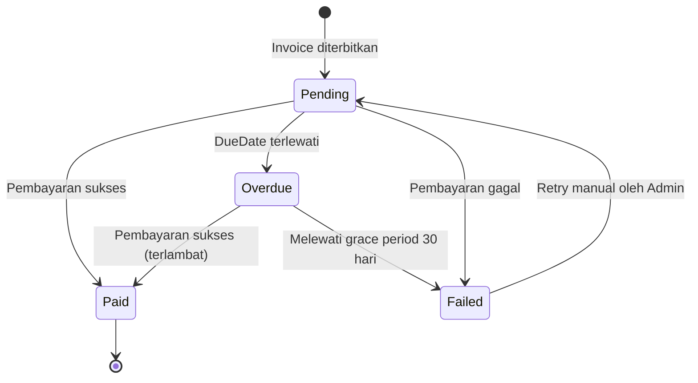

# Product Requirements Document (PRD)

# Automated Billing System — Sistem Tagihan Berulang & Otomasi Faktur

| Atribut | Nilai |
|---|---|
| **Versi dokumen** | 1.0 |
| **Tanggal** | 19 Oktober 2026 |
| **Status** | Draft untuk implementasi (MVP) |
| **Tech stack** | .NET 8, C#, Entity Framework Core, SQL Server, Azure Storage Queue (Azurite), Worker Service |
| **Dokumen terkait** | [Architecture.md](./Architecture.md) · [Rules.md](./Rules.md) · [Design_system.md](./Design_system.md) |

---

## Daftar Isi

1. [Project Overview & Executive Summary](#1-project-overview--executive-summary)
2. [Goals, Non-Goals & Success Metrics](#2-goals-non-goals--success-metrics)
3. [User Personas](#3-user-personas)
4. [Scope MVP](#4-scope-mvp)
5. [Core Features & Epics](#5-core-features--epics)
6. [Non-Functional Requirements](#6-non-functional-requirements)
7. [User Stories & Acceptance Criteria](#7-user-stories--acceptance-criteria)
8. [Asumsi, Risiko & Dependensi](#8-asumsi-risiko--dependensi)
9. [Roadmap & Milestone](#9-roadmap--milestone)
10. [Glosarium](#10-glosarium)

---

## 1. Project Overview & Executive Summary

### 1.1 Ringkasan Eksekutif

**Automated Billing System** adalah platform backend yang mengotomasi seluruh siklus pendapatan berulang (*recurring revenue cycle*) untuk bisnis berbasis langganan (SaaS): mulai dari pengelolaan paket dan langganan, pengecekan jatuh tempo, penerbitan faktur (*invoice*) otomatis, hingga pelacakan status pembayaran dan jejak audit.

Sistem dirancang dengan prinsip **asynchronous, idempotent, dan auditable**:

- **Asynchronous** — proses berat (penerbitan faktur massal) dipindahkan dari Web API ke **Worker Service** melalui **Azure Storage Queue**, sehingga API tetap responsif.
- **Idempotent** — satu langganan tidak akan pernah ditagih dua kali untuk periode yang sama, meskipun pesan antrean terkirim berulang, worker di-restart, atau admin menekan tombol berkali-kali.
- **Auditable** — setiap perubahan penting (pembuatan faktur, perubahan status, penjadwalan job) tercatat di `AuditLogs` dan ditulis dalam transaksi atomik yang sama dengan perubahan datanya.

### 1.2 Problem Statement

Tim keuangan di perusahaan SaaS skala kecil–menengah umumnya menagih pelanggan secara semi-manual (spreadsheet, pengingat kalender, penyusunan faktur satu per satu). Pendekatan ini menimbulkan masalah:

| # | Masalah | Dampak Bisnis |
|---|---|---|
| P1 | Penerbitan faktur manual dan terlambat | Arus kas (*cash flow*) tertunda, *Days Sales Outstanding* (DSO) meningkat |
| P2 | Risiko **tagihan ganda** atau tagihan terlewat | Komplain pelanggan, kehilangan pendapatan, risiko *churn* |
| P3 | Tidak ada status faktur yang konsisten | Sulit memantau tunggakan; keputusan penagihan lambat |
| P4 | Tidak ada jejak audit | Sulit investigasi sengketa tagihan dan sulit lolos audit keuangan |
| P5 | Proses penagihan massal membebani sistem utama | Aplikasi lambat/timeout saat akhir bulan |

### 1.3 Solusi

Sistem otomasi **revenue cycle** dengan alur berikut:

```
Plan & Subscription  →  Pengecekan Jatuh Tempo  →  Penerbitan Invoice Otomatis
        →  Pelacakan Status (Pending → Paid / Overdue / Failed)  →  Audit Trail
```

1. Admin Keuangan mengelola **paket (plans)** dan **langganan (subscriptions)**.
2. **Billing Engine** (Worker Service) memindai langganan yang jatuh tempo secara terjadwal, atau saat admin memicu job secara manual.
3. Setiap langganan jatuh tempo menjadi **satu pesan** di Azure Storage Queue dan diproses secara paralel dan terkontrol.
4. Faktur diterbitkan secara **atomik** (Invoice + AuditLog + pergeseran `NextBillingDate` dalam satu transaksi) dengan **idempotency key** untuk mencegah tagihan ganda.
5. Status faktur dikelola oleh **state machine** yang ketat, dan dipantau lewat Admin Dashboard.

### 1.4 Nilai Proyek sebagai Portofolio

Proyek ini mendemonstrasikan kompetensi engineering level produksi: *clean architecture*, *event-driven processing*, *idempotency*, *transactional consistency*, *retry & poison-message handling*, *observability*, dan dokumentasi standar enterprise.

---

## 2. Goals, Non-Goals & Success Metrics

### 2.1 Goals

| ID | Goal |
|---|---|
| G1 | Mengotomasi penerbitan faktur berulang tanpa intervensi manual |
| G2 | Menjamin **nol tagihan ganda** untuk kombinasi (langganan, periode) yang sama |
| G3 | Menjaga Web API tetap responsif dengan memindahkan pemrosesan berat ke Worker |
| G4 | Menyediakan visibilitas status faktur dan pendapatan bagi Admin Keuangan |
| G5 | Menyediakan jejak audit lengkap untuk semua perubahan finansial |

### 2.2 Non-Goals (Di Luar Cakupan MVP)

- Integrasi payment gateway nyata (Midtrans/Xendit/Stripe) — MVP memakai **simulasi pembayaran** lewat abstraksi `IPaymentGateway`.
- Pengiriman email/WhatsApp faktur ke pelanggan (rencana v1.1).
- Proration (perhitungan prorata saat upgrade/downgrade), diskon/kupon, pajak (PPN), dan multi-currency.
- Portal swalayan pelanggan (*customer self-service portal*).
- Multi-tenancy penuh.

### 2.3 Success Metrics

| Metrik | Target | Cara Verifikasi |
|---|---|---|
| Tagihan ganda | **0** dalam 10.000 pesan duplikat yang disimulasikan | Integration test + load test lokal |
| Latensi `POST /api/v1/billing/trigger` | p95 < 200 ms | Load test (k6/NBomber) |
| Latensi endpoint baca (list invoice) | p95 < 300 ms pada 100.000 invoice | Load test + indeks DB |
| Throughput Worker (1 instance) | ≥ 20 faktur/detik (target lokal) | Benchmark Worker |
| Pesan *poison* yang hilang tanpa jejak | 0 | Audit log + poison queue |
| Cakupan test pada Domain & Application | ≥ 80% | Coverage report CI |

---

## 3. User Personas

### 3.1 Persona A — Admin Keuangan (Primary User)

| Atribut | Detail |
|---|---|
| **Nama** | Rina Kusuma |
| **Peran** | Finance Admin / Billing Specialist |
| **Usia / Pengalaman** | 29 tahun, 5 tahun di akuntansi, nyaman dengan spreadsheet dan dashboard web |
| **Tujuan** | Faktur terbit tepat waktu, tunggakan terpantau, tutup buku bulanan tanpa lembur |
| **Frustrasi** | Harus menyusun faktur manual, takut menagih dua kali, sulit melacak siapa yang menunggak |
| **Kebutuhan sistem** | Dashboard ringkas, filter faktur berdasarkan status, tombol picu job penagihan, riwayat audit |
| **Kemampuan teknis** | Menengah — tidak menulis SQL, mengandalkan UI |

**Skenario khas:** Rina membuka dashboard setiap pagi, melihat jumlah faktur *Pending* dan *Overdue*, memfilter faktur yang menunggak, menandai faktur yang sudah dibayar, dan sesekali memicu job penagihan manual saat verifikasi akhir bulan.

### 3.2 Persona B — Pelanggan SaaS (Secondary / Beneficiary)

| Atribut | Detail |
|---|---|
| **Nama** | Budi Hartono |
| **Peran** | Pemilik usaha kecil yang berlangganan layanan SaaS |
| **Tujuan** | Ditagih tepat jumlah dan tepat waktu, tanpa tagihan ganda |
| **Frustrasi** | Menerima faktur ganda atau faktur dengan nominal salah |
| **Interaksi dengan sistem** | **Tidak langsung** pada MVP — datanya dikelola Admin; menerima faktur (via kanal lain) pada v1.1 |

**Implikasi desain:** Persona B menjadi alasan utama fitur *anti-double billing*, akurasi nominal (snapshot harga paket), dan status faktur yang jelas.

### 3.3 Persona C — Engineer / Reviewer Teknis (Stakeholder Portofolio)

Rekruter dan engineering manager yang menilai kualitas arsitektur, konsistensi dokumentasi, dan praktik engineering. Dipenuhi lewat dokumen yang selaras, README, dan test otomatis.

---

## 4. Scope MVP

| Area | In Scope (MVP) | Out of Scope |
|---|---|---|
| Master data | CRUD Customer, Plan, Subscription | Import massal CSV |
| Billing | Pemindaian jatuh tempo terjadwal + trigger manual, penerbitan invoice | Proration, pajak, diskon |
| Invoice | State machine, perubahan status manual (simulasi pembayaran) | Payment gateway nyata |
| Reliability | Idempotency, retry berjenjang, poison queue | Outbox pattern penuh (roadmap) |
| Audit | Audit log append-only untuk entitas utama | Export audit ke SIEM |
| UI | Admin Dashboard (lihat [Design_system.md](./Design_system.md)) | Portal pelanggan |
| Keamanan | JWT + role `FinanceAdmin` / `ReadOnlyAuditor` | SSO enterprise |

---

## 5. Core Features & Epics

### Ringkasan Epic

| Epic | Nama | Prioritas |
|---|---|---|
| **E1** | Manajemen Langganan & Paket | P0 |
| **E2** | Automated Recurring Billing Engine | P0 |
| **E3** | State Machine Status Invoice | P0 |
| **E4** | Audit Logging & Anti-Double Billing (Idempotency) | P0 |
| **E5** | Dashboard & Reporting (pendukung) | P1 |

---

### Epic E1 — Manajemen Langganan & Paket (CRUD Subscriptions & Plans)

**Deskripsi:** Admin dapat mengelola pelanggan, paket harga, dan langganan yang menghubungkan keduanya.

| ID | Requirement | Prioritas |
|---|---|---|
| FR-101 | Sistem menyediakan CRUD **Customer** (nama, email unik, perusahaan, alamat penagihan). Penghapusan bersifat *soft* (deaktivasi). | P0 |
| FR-102 | Sistem menyediakan CRUD **SubscriptionPlan** (nama, deskripsi, harga, mata uang, siklus: `Monthly`/`Quarterly`/`Yearly`). Paket yang sudah dipakai tidak dapat dihapus, hanya dinonaktifkan. | P0 |
| FR-103 | Sistem dapat membuat **Subscription** untuk Customer aktif pada Plan aktif dengan `StartDate`; `NextBillingDate` awal = `StartDate`. | P0 |
| FR-104 | Subscription mendukung siklus hidup: `Active` → `Paused` → `Active`, `Active/Paused` → `Cancelled`, dan `Expired` (otomatis saat melewati `EndDate`). | P0 |
| FR-105 | Perubahan harga pada Plan **tidak** mengubah faktur yang sudah terbit (harga disalin sebagai *snapshot* ke Invoice). | P0 |
| FR-106 | Sistem mendukung pencarian dan pagination pada daftar Customer, Plan, dan Subscription. | P1 |

---

### Epic E2 — Automated Recurring Billing Engine

**Deskripsi:** Engine yang mengecek langganan jatuh tempo dan menerbitkan faktur secara otomatis dan asinkron.

| ID | Requirement | Prioritas |
|---|---|---|
| FR-201 | **Scheduler** pada Worker menjalankan pemindaian periodik (default tiap 60 menit, dapat dikonfigurasi) untuk Subscription dengan `Status = Active` dan `NextBillingDate ≤ tanggal bisnis hari ini`. | P0 |
| FR-202 | Untuk setiap langganan jatuh tempo, sistem membuat **satu pesan `InvoiceJobMessage`** di Azure Storage Queue (`billing-invoice-jobs`) — satu pesan per (langganan, periode). | P0 |
| FR-203 | Worker (`InvoiceJobConsumer`) memproses pesan, menerbitkan Invoice (nomor unik, periode tagihan, nominal snapshot, `IssueDate`, `DueDate = IssueDate + 14 hari`) dan menggeser `NextBillingDate` ke periode berikutnya. | P0 |
| FR-204 | Admin dapat **memicu job penagihan manual** lewat `POST /api/v1/billing/trigger`. API hanya menerima permintaan, mencatat audit, mengirim `ScanRequestMessage` ke `billing-scan-requests`, lalu merespons `202 Accepted` — **tanpa** memproses penagihan di thread request. | P0 |
| FR-205 | Mode **simulasi**: trigger manual dapat menerima `asOfDate` (hanya bila `Billing:AllowSimulatedDate = true`) untuk mensimulasikan penagihan pada tanggal tertentu. | P1 |
| FR-206 | Jika Worker sempat mati (*downtime*), periode yang terlewat ditagih bertahap (satu periode per siklus pemindaian) hingga `NextBillingDate` mengejar tanggal hari ini. | P0 |
| FR-207 | Langganan `Paused`, `Cancelled`, atau `Expired` **tidak** pernah ditagih. | P0 |
| FR-208 | Kegagalan sementara (*transient*) diproses ulang dengan **retry berjenjang**; pesan yang tetap gagal dipindahkan ke **poison queue** dan dicatat di audit. | P0 |

---

### Epic E3 — State Machine Status Invoice

**Deskripsi:** Status faktur hanya boleh berubah melalui transisi yang valid.



| ID | Requirement | Prioritas |
|---|---|---|
| FR-301 | Invoice baru selalu berstatus `Pending`. | P0 |
| FR-302 | Transisi valid hanya: `Pending→Paid`, `Pending→Overdue`, `Pending→Failed`, `Overdue→Paid`, `Overdue→Failed`, `Failed→Pending`. Transisi lain ditolak dengan `409 Conflict`. | P0 |
| FR-303 | `Paid` bersifat **terminal** dan immutable — tidak dapat diubah lagi. | P0 |
| FR-304 | Job **Overdue Sweeper** (di Worker) otomatis mengubah `Pending` → `Overdue` ketika `DueDate` < tanggal bisnis hari ini. | P0 |
| FR-305 | `Overdue` yang melewati *grace period* (default 30 hari sejak `DueDate`) otomatis menjadi `Failed`. | P1 |
| FR-306 | Setiap transisi status mencatat `AuditLog` (status lama, status baru, aktor, alasan) dalam transaksi yang sama. | P0 |
| FR-307 | Admin dapat mengubah status lewat `PATCH /api/v1/invoices/{id}/status` (simulasi pembayaran) dengan `reason` wajib untuk `Failed`. | P0 |

---

### Epic E4 — Audit Logging & Anti-Double Billing (Idempotency)

**Deskripsi:** Menjamin tidak ada tagihan ganda dan semua perubahan penting terekam.

| ID | Requirement | Prioritas |
|---|---|---|
| FR-401 | Setiap Invoice memiliki `IdempotencyKey` berformat `INV:{SubscriptionId}:{yyyyMMdd periode mulai}` dengan **unique index** di database. | P0 |
| FR-402 | Terdapat **unique index tambahan** pada (`SubscriptionId`, `BillingPeriodStart`) sebagai pertahanan lapis kedua. | P0 |
| FR-403 | Pemrosesan pesan duplikat (pesan terkirim ganda, redelivery, trigger berulang) menghasilkan **hasil yang sama tanpa efek samping** (faktur tidak dibuat ulang; pesan dianggap sukses). | P0 |
| FR-404 | Pembuatan Invoice + AuditLog + pergeseran `NextBillingDate` dilakukan dalam **satu transaksi atomik**; gagal sebagian = *rollback* seluruhnya. | P0 |
| FR-405 | `AuditLogs` bersifat **append-only** (tidak ada UPDATE/DELETE dari aplikasi). | P0 |
| FR-406 | Audit mencatat: aktor (`System`/ID admin), `CorrelationId`, entitas, aksi, nilai lama/baru (JSON), waktu UTC. | P0 |
| FR-407 | Admin dapat melihat dan memfilter audit log berdasarkan entitas, aksi, dan rentang waktu. | P1 |

---

### Epic E5 — Dashboard & Reporting (Pendukung)

| ID | Requirement | Prioritas |
|---|---|---|
| FR-501 | `GET /api/v1/dashboard/summary` mengembalikan **Total Revenue**, **Pending Invoices**, dan **Active Subscriptions**. | P1 |
| FR-502 | `GET /api/v1/invoices` mendukung filter status, pencarian, sorting, dan pagination sisi server. | P0 |
| FR-503 | Admin Dashboard sesuai spesifikasi [Design_system.md](./Design_system.md). | P1 |

---

## 6. Non-Functional Requirements

### 6.1 Performa

| ID | Requirement | Target |
|---|---|---|
| NFR-P1 | Endpoint trigger manual hanya melakukan *enqueue* | p95 < 200 ms |
| NFR-P2 | Endpoint baca dengan pagination (≤ 100 item/halaman) | p95 < 300 ms |
| NFR-P3 | Worker memproses pesan paralel terkontrol (`MaxConcurrency`, default 8) | ≥ 20 faktur/detik/instance |
| NFR-P4 | Query list menggunakan indeks yang sesuai (Status, DueDate, CustomerId, NextBillingDate) dan *keyset-safe ordering* deterministik | Tanpa full table scan pada query utama |
| NFR-P5 | Pemrosesan massal tidak boleh menahan thread request API | Pemisahan proses Api ↔ Worker |

### 6.2 Keamanan Data

| ID | Requirement |
|---|---|
| NFR-S1 | Autentikasi **JWT Bearer**; otorisasi berbasis role (`FinanceAdmin` = baca/tulis, `ReadOnlyAuditor` = baca saja). |
| NFR-S2 | Seluruh traffic via **HTTPS/TLS**; koneksi SQL dan Storage memakai enkripsi in-transit. |
| NFR-S3 | Secret (connection string, signing key) **tidak** disimpan di repositori — gunakan *User Secrets* (dev) dan Azure Key Vault/environment variable (prod). |
| NFR-S4 | Data PII (email, alamat) tidak boleh muncul di log aplikasi; gunakan masking dan ID. |
| NFR-S5 | Semua input divalidasi (FluentValidation); query selalu terparameter (EF Core) untuk mencegah SQL injection. |
| NFR-S6 | Endpoint trigger dikenai **rate limiting** (1 request/menit per pengguna) untuk mencegah *queue flooding*. |
| NFR-S7 | `AuditLogs` tidak dapat diubah dari jalur aplikasi (hak DB aplikasi: INSERT/SELECT saja pada tabel ini). |
| NFR-S8 | Mengikuti OWASP ASVS L1 sebagai baseline: *security headers*, CORS terbatas, tidak membocorkan stack trace (ProblemDetails). |

### 6.3 Ketersediaan & Keandalan Queue

| ID | Requirement |
|---|---|
| NFR-A1 | Semantik pengiriman **at-least-once**; konsistensi dijaga oleh idempotency (bukan oleh asumsi *exactly-once*). |
| NFR-A2 | Pesan baru dihapus dari queue **hanya setelah** transaksi database berhasil di-commit. |
| NFR-A3 | Retry berjenjang dengan *exponential backoff* + jitter; maksimum **5 percobaan** (`DequeueCount`), setelah itu ke **poison queue** `billing-invoice-jobs-poison`. |
| NFR-A4 | Worker mendukung *graceful shutdown*: selesaikan pesan yang sedang berjalan, tidak mengambil pesan baru. |
| NFR-A5 | Worker bersifat **stateless** sehingga dapat di-*scale out* (beberapa instance) tanpa koordinasi tambahan — benturan dicegah oleh idempotency dan unique index. |
| NFR-A6 | Endpoint *health check*: `/health/live` dan `/health/ready` (cek SQL Server dan Queue). |
| NFR-A7 | Target ketersediaan API 99,5% (target portofolio/lingkungan demo); kegagalan Worker tidak boleh membuat API mati. |

### 6.4 Observability & Maintainability

| ID | Requirement |
|---|---|
| NFR-O1 | Logging terstruktur (Serilog) dengan `CorrelationId` yang dibawa dari API → pesan queue → Worker. |
| NFR-O2 | Metrik minimal: jumlah faktur diterbitkan, duplikat dilewati, retry, poison, durasi proses. |
| NFR-O3 | Test: unit (Domain/Application), integration (SQL Server container + Azurite), dan test idempotency konkuren. |
| NFR-O4 | CI menjalankan build, test, dan *format check*; commit mengikuti Conventional Commits (lihat [Rules.md](./Rules.md)). |

---

## 7. User Stories & Acceptance Criteria

Format AC: **Given / When / Then**.

### Epic E1 — Manajemen Langganan & Paket

**US-101 — Mengelola Customer**
> Sebagai **Admin Keuangan**, saya ingin menambah dan mengubah data pelanggan agar penagihan memiliki data penerima yang benar.

- **AC1:** *Given* data valid, *When* saya membuat customer, *Then* sistem menyimpan customer dan mengembalikan `201 Created` beserta `Location` header.
- **AC2:** *Given* email sudah terdaftar, *When* saya membuat customer baru dengan email tersebut, *Then* sistem menolak dengan `409 Conflict`.
- **AC3:** *Given* customer memiliki langganan aktif, *When* saya menonaktifkannya, *Then* sistem menolak dengan pesan bahwa langganan harus dibatalkan terlebih dahulu.

**US-102 — Mengelola Paket (Plan)**
> Sebagai **Admin Keuangan**, saya ingin mendefinisikan paket dengan harga dan siklus agar langganan memiliki aturan harga yang jelas.

- **AC1:** *Given* harga > 0 dan siklus valid, *When* saya membuat plan, *Then* plan tersimpan dengan `IsActive = true`.
- **AC2:** *Given* harga ≤ 0, *When* saya menyimpan plan, *Then* sistem mengembalikan `400 Bad Request` dengan detail validasi.
- **AC3:** *Given* plan sudah dipakai langganan, *When* saya mengubah harga, *Then* invoice yang sudah terbit **tidak** berubah nominalnya.

**US-103 — Membuat Langganan**
> Sebagai **Admin Keuangan**, saya ingin membuat langganan untuk pelanggan pada suatu paket agar penagihan berulang berjalan otomatis.

- **AC1:** *Given* customer aktif dan plan aktif, *When* saya membuat langganan dengan `StartDate`, *Then* langganan berstatus `Active` dan `NextBillingDate = StartDate`.
- **AC2:** *Given* plan nonaktif, *When* saya membuat langganan, *Then* sistem menolak dengan `400`/`409`.
- **AC3:** *Given* saya membuat langganan, *Then* sebuah `AuditLog` bertipe `SubscriptionCreated` tercatat.

**US-104 — Menjeda, Melanjutkan, dan Membatalkan Langganan**
> Sebagai **Admin Keuangan**, saya ingin menjeda atau membatalkan langganan agar pelanggan tidak ditagih saat tidak berhak.

- **AC1:** *Given* langganan `Active`, *When* saya menjeda, *Then* status `Paused` dan tidak ada pesan penagihan baru untuknya.
- **AC2:** *Given* langganan `Paused`, *When* saya melanjutkan, *Then* status `Active` dan `NextBillingDate = max(NextBillingDate, hari ini)` (tidak ada penagihan mundur untuk masa jeda).
- **AC3:** *Given* langganan `Cancelled`, *Then* tidak ada faktur baru; faktur yang sudah ada tetap valid.

### Epic E2 — Automated Recurring Billing Engine

**US-201 — Penagihan Otomatis Terjadwal**
> Sebagai **Admin Keuangan**, saya ingin faktur terbit otomatis saat langganan jatuh tempo agar saya tidak menyusunnya manual.

- **AC1:** *Given* langganan `Active` dengan `NextBillingDate ≤ hari ini`, *When* scheduler berjalan, *Then* satu pesan `InvoiceJobMessage` dikirim ke `billing-invoice-jobs`.
- **AC2:** *Given* pesan diproses sukses, *Then* satu Invoice `Pending` terbit dengan `DueDate = IssueDate + 14 hari` dan `NextBillingDate` maju satu siklus.
- **AC3:** *Given* langganan `Paused/Cancelled/Expired`, *Then* tidak ada pesan yang dikirim.

**US-202 — Trigger Penagihan Manual**
> Sebagai **Admin Keuangan**, saya ingin memicu job penagihan secara manual agar saya dapat memverifikasi atau mensimulasikan siklus penagihan.

- **AC1:** *Given* saya terautentikasi sebagai `FinanceAdmin`, *When* saya memanggil `POST /api/v1/billing/trigger`, *Then* API merespons `202 Accepted` dengan `runId` dalam < 200 ms (p95).
- **AC2:** *Given* trigger diterima, *Then* `AuditLog` bertipe `BillingRunRequested` tercatat dan `ScanRequestMessage` masuk `billing-scan-requests`.
- **AC3:** *Given* saya memanggil trigger lagi dalam 60 detik, *Then* API membalas `429 Too Many Requests` dengan header `Retry-After`.
- **AC4:** *Given* `Billing:AllowSimulatedDate = false`, *When* saya menyertakan `asOfDate`, *Then* API menolak dengan `400`.
- **AC5:** *Given* user `ReadOnlyAuditor`, *When* memanggil trigger, *Then* API membalas `403 Forbidden`.

**US-203 — Pemulihan Setelah Downtime**
> Sebagai **Admin Keuangan**, saya ingin periode yang terlewat tetap tertagih setelah sistem pulih agar tidak ada pendapatan yang hilang.

- **AC1:** *Given* Worker mati selama dua periode, *When* Worker menyala kembali, *Then* periode yang terlewat ditagih bertahap, satu periode per siklus pemindaian, hingga `NextBillingDate` melewati hari ini.
- **AC2:** *Given* proses pemulihan, *Then* tidak ada periode yang tertagih dua kali.

**US-204 — Ketahanan Terhadap Kegagalan Sementara**
> Sebagai **Engineer Operasional**, saya ingin pesan yang gagal sementara dicoba ulang otomatis agar tidak ada tagihan yang hilang karena gangguan singkat.

- **AC1:** *Given* SQL Server tidak dapat dijangkau sesaat, *When* pesan diproses, *Then* pesan tidak dihapus dan muncul kembali setelah backoff (30 dtk → 2 mnt → 10 mnt → 30 mnt).
- **AC2:** *Given* percobaan ke-5 gagal, *Then* pesan dipindahkan ke `billing-invoice-jobs-poison` dan `AuditLog` bertipe `InvoiceJobDeadLettered` tercatat.
- **AC3:** *Given* pesan rusak (JSON tidak valid), *Then* pesan langsung ke poison queue tanpa retry.

### Epic E3 — State Machine Status Invoice

**US-301 — Memantau Status Invoice**
> Sebagai **Admin Keuangan**, saya ingin melihat status setiap faktur agar saya tahu mana yang perlu ditindaklanjuti.

- **AC1:** *Given* invoice baru, *Then* statusnya `Pending`.
- **AC2:** *Given* invoice `Pending` dengan `DueDate` kemarin, *When* Overdue Sweeper berjalan, *Then* status menjadi `Overdue` dan audit log tercatat.

**US-302 — Menandai Pembayaran**
> Sebagai **Admin Keuangan**, saya ingin menandai faktur sebagai `Paid` atau `Failed` untuk mensimulasikan hasil pembayaran.

- **AC1:** *Given* invoice `Pending` atau `Overdue`, *When* saya set `Paid`, *Then* `PaidAt` terisi, status `Paid`, dan audit tercatat.
- **AC2:** *Given* invoice `Paid`, *When* saya mencoba mengubah status apa pun, *Then* API membalas `409 Conflict`.
- **AC3:** *Given* invoice `Pending`, *When* saya set `Failed` tanpa `reason`, *Then* API membalas `400`.
- **AC4:** *Given* invoice `Failed`, *When* saya memilih *Retry*, *Then* status kembali `Pending`.

**US-303 — Transisi Tidak Valid Ditolak**
> Sebagai **Engineer**, saya ingin sistem menolak transisi status yang tidak sah agar data finansial tetap konsisten.

- **AC1:** *Given* transisi tidak ada pada matriks FR-302 (mis. `Pending → Pending` atau `Paid → Overdue`), *Then* API membalas `409` dengan `ProblemDetails` yang menyebut transisi asal dan tujuan.

### Epic E4 — Audit Logging & Anti-Double Billing

**US-401 — Tidak Ada Tagihan Ganda**
> Sebagai **Pelanggan SaaS**, saya tidak ingin ditagih dua kali untuk periode yang sama.

- **AC1:** *Given* dua pesan identik untuk (langganan X, periode P) diproses bersamaan oleh dua Worker, *Then* hanya **satu** Invoice yang tersimpan; pesan kedua dianggap duplikat dan dihapus.
- **AC2:** *Given* admin menekan trigger tiga kali berturut-turut (di luar rate limit), *Then* hasil akhirnya tetap satu invoice per (langganan, periode).
- **AC3:** *Given* Worker crash setelah commit DB namun sebelum menghapus pesan, *When* pesan muncul kembali, *Then* sistem mendeteksi duplikat dan tidak membuat invoice baru.

**US-402 — Konsistensi Transaksional**
> Sebagai **Auditor**, saya ingin setiap invoice selalu memiliki audit log pasangan agar jejak keuangan lengkap.

- **AC1:** *Given* penerbitan invoice, *Then* Invoice, AuditLog (`InvoiceIssued`), dan pergeseran `NextBillingDate` tersimpan **atau** tidak sama sekali.
- **AC2:** *Given* penyimpanan AuditLog gagal, *Then* Invoice tidak tersimpan (rollback) dan pesan diproses ulang sesuai kebijakan retry.

**US-403 — Menelusuri Audit Log**
> Sebagai **Auditor/Admin**, saya ingin mencari audit log berdasarkan entitas dan rentang waktu.

- **AC1:** *Given* filter `entityName=Invoice&entityId={id}`, *Then* API mengembalikan seluruh riwayat invoice tersebut, terurut menurun berdasarkan waktu.
- **AC2:** *Given* percobaan UPDATE/DELETE pada AuditLogs dari aplikasi, *Then* operasi ditolak oleh hak akses database.

### Epic E5 — Dashboard

**US-501 — Ringkasan Dashboard**
> Sebagai **Admin Keuangan**, saya ingin melihat total pendapatan, faktur tertunda, dan langganan aktif dalam sekali lihat.

- **AC1:** *Given* data tersedia, *When* dashboard dibuka, *Then* tiga kartu ringkasan tampil dari `GET /api/v1/dashboard/summary`.
- **AC2:** *Given* tidak ada data, *Then* kartu menampilkan nilai 0 dan *empty state* yang informatif.

**US-502 — Menelusuri Daftar Invoice**
> Sebagai **Admin Keuangan**, saya ingin memfilter, mencari, mengurutkan, dan memaginasi faktur agar menemukan faktur tertentu dengan cepat.

- **AC1:** *Given* filter `status=Overdue`, *Then* hanya invoice `Overdue` yang tampil.
- **AC2:** *Given* kata kunci nomor invoice atau nama/email customer, *Then* hasil sesuai.
- **AC3:** *Given* `sortBy=dueDate&sortDir=asc`, *Then* hasil terurut dan stabil antarhalaman.

---

## 8. Asumsi, Risiko & Dependensi

### 8.1 Asumsi

- Seluruh nilai uang memakai `decimal(18,2)`; mata uang default **IDR**.
- Tanggal bisnis dievaluasi pada zona waktu **Asia/Jakarta (WIB)**; timestamp teknis disimpan **UTC**.
- Satu Plan = satu mata uang; satu Subscription = satu Plan.
- Pembayaran pada MVP disimulasikan oleh Admin.

### 8.2 Risiko & Mitigasi

| Risiko | Dampak | Mitigasi |
|---|---|---|
| Pesan terkirim dua kali (at-least-once) | Tagihan ganda | Idempotency key + unique index + penanganan `DbUpdateException` |
| Worker crash di tengah proses | Data setengah jadi | Transaksi atomik; pesan dihapus setelah commit |
| Lonjakan pesan saat akhir bulan | Antrean menumpuk | Scale-out Worker, `MaxConcurrency`, monitoring panjang antrean |
| Batas ukuran pesan Azure Queue (64 KB) | Pesan ditolak | Pesan hanya membawa ID & periode, bukan payload besar |
| Drift tanggal bulan (31 Jan → 28 Feb) | Tanggal tagih bergeser | Hitung `NextBillingDate` dari `StartDate` + indeks periode (lihat [Rules.md](./Rules.md)) |
| Enqueue gagal setelah commit audit | Run tercatat tapi tidak berjalan | Audit `BillingRunEnqueueFailed` + respons 503; *Outbox pattern* pada roadmap |

### 8.3 Dependensi

- SQL Server 2019+ (container `mssql/server:2022-latest` untuk pengembangan lokal).
- Azurite (emulator Azure Storage) untuk pengembangan lokal; Azure Storage Account untuk produksi.
- .NET 8 SDK, Docker Desktop.

---

## 9. Roadmap & Milestone

| Fase | Fokus | Deliverable |
|---|---|---|
| **M1 — Foundation** | Solution structure, domain model, migrasi EF Core, CRUD Customer/Plan/Subscription | API CRUD + test dasar |
| **M2 — Billing Engine** | Queue integration, Scheduler, ScanRequest & InvoiceJob consumer, idempotency | Penerbitan invoice otomatis end-to-end |
| **M3 — Invoice Lifecycle** | State machine, Overdue Sweeper, audit log | Status invoice & audit lengkap |
| **M4 — Reliability** | Retry berjenjang, poison queue, graceful shutdown, health check | Test chaos/duplikat lolos |
| **M5 — Dashboard** | Admin Dashboard sesuai Design_system.md | UI demo |
| **M6 — Polish** | Dokumentasi, CI, load test, README | Siap ditunjukkan ke rekruter |

**Backlog v1.1+:** notifikasi email faktur, payment gateway nyata, pajak/diskon, proration, Outbox pattern, portal pelanggan.

---

## 10. Glosarium

| Istilah | Arti |
|---|---|
| **Revenue cycle** | Siklus dari penetapan harga hingga penerimaan pembayaran |
| **Subscription** | Langganan pelanggan atas suatu paket secara berulang |
| **Billing period** | Rentang waktu layanan yang ditagih dalam satu faktur |
| **Idempotency** | Properti: operasi yang diulang menghasilkan efek yang sama dengan sekali eksekusi |
| **Poison message** | Pesan yang terus gagal diproses dan dikarantina ke antrean khusus |
| **DSO** | *Days Sales Outstanding* — rata-rata hari untuk menerima pembayaran |
| **Grace period** | Masa tenggang setelah jatuh tempo sebelum faktur dianggap gagal |
| **Visibility timeout** | Waktu pesan antrean disembunyikan setelah diambil consumer |
