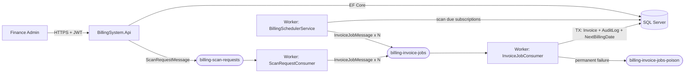
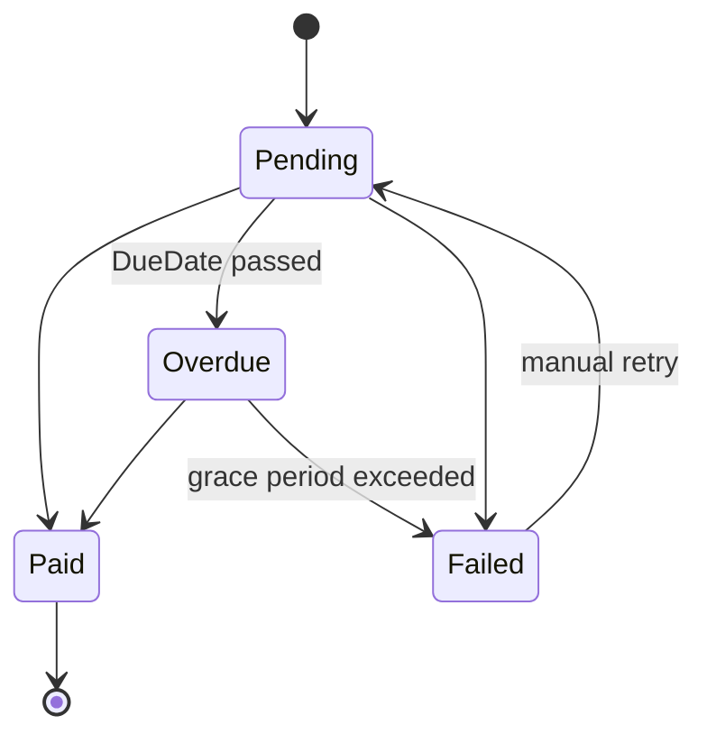

<div align="center">

# 💳 Automated Billing System

### .NET 8 Enterprise Billing Engine

Recurring billing, automated invoicing, and idempotent asynchronous processing, built with Clean Architecture.

[](https://dotnet.microsoft.com/)
[](https://learn.microsoft.com/dotnet/csharp/)
[](https://www.microsoft.com/sql-server)
[](https://www.docker.com/)
[](https://learn.microsoft.com/azure/storage/queues/)
[](https://xunit.net/)
[](./LICENSE)

</div>

---

## 📖 Overview

**Automated Billing System** is a backend platform that automates the entire recurring revenue cycle of a subscription business: subscription and plan management, due-date detection, invoice issuance, invoice lifecycle tracking, and a complete audit trail. It is built on **Clean Architecture** with a strict dependency rule, so business rules live in the Domain and Application layers and stay independent of frameworks, databases, and message brokers.

Correctness under failure is the central design goal. Delivery from the queue is **at-least-once**, so the system relies on **idempotency guarantees** (an `IdempotencyKey` backed by database unique indexes) to ensure a subscription is never billed twice for the same period, even when messages are redelivered, workers crash, or an admin triggers a job repeatedly. Heavy work is moved off the request path through **asynchronous message processing**: the API accepts a request and returns `202 Accepted`, while a separate **Worker Service** consumes **Azure Storage Queue** messages, issues invoices atomically, retries transient failures with exponential backoff, and quarantines unprocessable messages in a poison queue.

> **Project status:** Milestones 1–5 are complete (foundation, billing engine, invoice lifecycle, reliability, dashboard API). See [Linked Architecture Documents](#-linked-architecture-documents) for the full specification.

---

## 🏛️ Architecture Overview & Tech Stack

### Clean Architecture

The solution is split into five projects. Dependencies point inward only.

```
Api ─────────┐
             ├──► Application ──► Domain
Worker ──────┤          ▲
             │          │ implements abstractions
             └──► Infrastructure
```

| Layer | Project | Responsibility |
|---|---|---|
| 🧩 **Domain** | `BillingSystem.Domain` | Entities, enums, the invoice state machine, and domain rules. No external dependencies. |
| ⚙️ **Application** | `BillingSystem.Application` | Use cases and services, DTOs, FluentValidation validators, abstractions (`TimeProvider`, queue publisher, payment gateway), and queue message contracts. |
| 🗄️ **Infrastructure** | `BillingSystem.Infrastructure` | EF Core `DbContext`, entity configurations, migrations, and the Azure Storage Queue implementation. |
| 🌐 **Api** | `BillingSystem.Api` | REST API, JWT authentication, rate limiting, ProblemDetails error handling, Swagger, and health checks. A composition root only. |
| 🔄 **Worker** | `BillingSystem.Worker` | Background hosted services: the scheduler, the scan-request consumer, and the invoice-job consumer. |

### High-Level Flow



### Tech Stack

| Category | Technology |
|---|---|
| Runtime & language | **.NET 8 (LTS)**, **C# 12** |
| Web API | ASP.NET Core 8 |
| Background processing | .NET Worker Service (`BackgroundService`) |
| ORM & database | **Entity Framework Core 8**, **SQL Server 2022** (Docker) |
| Messaging | **Azure Queue Storage** (local emulator: **Azurite**) |
| Validation | **FluentValidation** |
| Observability | **Health Checks** (liveness and readiness), structured logging with correlation IDs, audit logs |
| Testing | **xUnit** |
| Tooling | Docker Compose, Swagger / OpenAPI |

---

## ✨ Key Features & Business Rules Compliance

Business rules are numbered (`BR-xx`) and defined in [Rules.md](./Rules.md). Each feature below maps to the rules it enforces.

### 🤖 Automated Billing Engine

- **Periodic scanning:** `BillingSchedulerService` runs on a configurable interval (default 60 minutes), finds `Active` subscriptions whose `NextBillingDate` is due, and enqueues **one message per (subscription, billing period)**.
- **Manual trigger:** `POST /api/v1/billing/trigger` enqueues a single `ScanRequestMessage` and returns `202 Accepted` immediately. Fan-out happens in the Worker, so API latency does not depend on the number of subscriptions.
- **Background workers:** `InvoiceJobConsumer` processes messages concurrently, with a bounded degree of parallelism.
- **Catch-up after downtime:** missed periods are billed one per scan cycle until `NextBillingDate` catches up (BR-10).

### 🔐 Strict Idempotency (BR-01 → BR-08)

| Rule | Guarantee |
|---|---|
| **BR-01** | Every invoice carries an `IdempotencyKey` (`INV:{SubscriptionId}:{yyyyMMdd}`) produced only by `IdempotencyKeyFactory`. |
| **BR-02** | **Unique indexes** on `IdempotencyKey` and on (`SubscriptionId`, `BillingPeriodStart`). The database is the authoritative guard. |
| **BR-03** | Only `Active` subscriptions with `NextBillingDate ≤ AsOfDate` are billed. |
| **BR-04** | A stale message (period does not match `NextBillingDate`) is skipped and audited. |
| **BR-05 / BR-06** | A duplicate is treated as a **successful no-op**. A SQL unique violation (2601 / 2627) is handled as a duplicate, not as an error. |
| **BR-07** | `NextBillingDate` is computed from `StartDate` plus a period index, which prevents month-end drift. |
| **BR-08** | The plan price is **snapshotted** onto the invoice at issuance. |

### 🔁 Invoice State Machine (BR-50 → BR-54) & Atomic Transactions



- Status changes are possible **only** through `Invoice.TransitionTo(...)`. Invalid transitions raise a domain exception and surface as `409 Conflict`.
- `Paid` is **terminal and immutable**. `Failed` requires a reason.
- **Atomic transactions (BR-40/41):** invoice creation, its audit log entry, and the `NextBillingDate` advance commit together or roll back together.

### 🧹 Overdue Sweeper Service

- Moves `Pending` invoices to `Overdue` when `DueDate` has passed.
- Moves `Overdue` invoices to `Failed` after the configurable **grace period** (default 30 days).
- Works in **batches of at most 500 invoices per transaction** (BR-46), writing an audit log entry for each status change.

### 🛡️ Reliability & Resilience (BR-20 → BR-30)

| Mechanism | Behavior |
|---|---|
| **Delete after commit** | A message is removed from the queue only after the database transaction commits (BR-20). |
| **Exponential backoff with jitter** | 30 s → 2 min → 10 min → 30 min, with ±20% jitter (BR-22). |
| **Max attempts** | `MaxDequeueCount = 5` (BR-21). |
| **Poison queue** | Failed and malformed messages go to `billing-invoice-jobs-poison` inside a `PoisonEnvelope`, with an `InvoiceJobDeadLettered` audit entry (BR-25, BR-28). |
| **Error classification** | Duplicate, business skip, transient, malformed, and unknown errors each have a defined handling path (see Rules.md §2.2). |
| **Graceful shutdown** | Honors the cancellation token, stops taking new messages, and lets in-flight work finish (BR-30). |

### 📊 Dashboard API & Observability

- **Real-time billing metrics:** `GET /api/v1/dashboard/summary` returns total revenue, pending invoices, and active subscriptions.
- **Audit logging:** append-only `AuditLogs` with actor, `CorrelationId`, and old/new values. The correlation ID travels from the API through the queue to the Worker.
- **Health checks:**

| Endpoint | Purpose |
|---|---|
| `GET /health/live` | Liveness: the process is running. |
| `GET /health/ready` | Readiness: SQL Server and the queue are reachable. |

---

## 📁 Project Structure

```
AutomatedBillingSystem/
├── src/
│   ├── BillingSystem.Domain/           # Entities, enums, state machine, domain rules
│   ├── BillingSystem.Application/      # Services, DTOs, validators, abstractions, message contracts
│   ├── BillingSystem.Infrastructure/   # EF Core, migrations, queue client, implementations
│   ├── BillingSystem.Api/              # REST API, auth, rate limiting, Swagger, health checks
│   └── BillingSystem.Worker/           # Scheduler, scan-request consumer, invoice-job consumer
├── tests/
│   ├── BillingSystem.Domain.Tests/         # Unit tests: state machine, period calculator
│   ├── BillingSystem.Application.Tests/    # Unit tests: services, validators, retry policy
│   └── BillingSystem.IntegrationTests/     # SQL Server + Azurite integration tests
├── docs/                               # PRD.md, Architecture.md, Rules.md, Design_system.md
├── docker-compose.yml                  # SQL Server + Azurite
├── Directory.Build.props               # Nullable, analyzers, TreatWarningsAsErrors
├── .editorconfig
├── LICENSE
└── BillingSystem.sln
```

---

## 🚀 Getting Started / Local Setup

### Prerequisites

| Tool | Version |
|---|---|
| [.NET SDK](https://dotnet.microsoft.com/download/dotnet/8.0) | 8.0+ |
| [Docker Desktop](https://www.docker.com/products/docker-desktop/) | Recent version with Compose v2 |
| EF Core CLI | `dotnet tool install --global dotnet-ef` |

### 1. Clone the repository

```bash
git clone https://github.com/<your-username>/AutomatedBillingSystem.git
cd AutomatedBillingSystem
```

### 2. Configure environment variables

Create a `.env` file next to `docker-compose.yml` (do **not** commit it):

```env
SA_PASSWORD=YourStrong!Passw0rd
```

Store application secrets with .NET User Secrets, never in source control:

```bash
cd src/BillingSystem.Api
dotnet user-secrets set "ConnectionStrings:BillingDb" "Server=localhost,1433;Database=BillingDb;User Id=sa;Password=YourStrong!Passw0rd;TrustServerCertificate=True"
dotnet user-secrets set "Storage:ConnectionString" "UseDevelopmentStorage=true"
dotnet user-secrets set "Jwt:SigningKey" "<a-long-random-secret>"

cd ../BillingSystem.Worker
dotnet user-secrets set "ConnectionStrings:BillingDb" "Server=localhost,1433;Database=BillingDb;User Id=sa;Password=YourStrong!Passw0rd;TrustServerCertificate=True"
dotnet user-secrets set "Storage:ConnectionString" "UseDevelopmentStorage=true"
cd ../..
```

Tune the billing behavior in `appsettings.json`:

```json
{
  "Billing": {
    "BusinessTimeZone": "Asia/Jakarta",
    "ScanIntervalMinutes": 60,
    "PaymentTermDays": 14,
    "OverdueGraceDays": 30,
    "AllowSimulatedDate": true
  },
  "Queues": {
    "ScanRequests": "billing-scan-requests",
    "InvoiceJobs": "billing-invoice-jobs",
    "InvoiceJobsPoison": "billing-invoice-jobs-poison",
    "MaxDequeueCount": 5,
    "MaxConcurrency": 8,
    "VisibilityTimeoutSeconds": 120,
    "MessageTtlDays": 7
  }
}
```

> ⚠️ Set `AllowSimulatedDate` to `false` outside demo and development environments.

### 3. Start infrastructure (SQL Server & Azurite)

```bash
docker compose up -d
```

### 4. Apply database migrations

```bash
dotnet ef database update \
  --project src/BillingSystem.Infrastructure \
  --startup-project src/BillingSystem.Api
```

### 5. Run the API and the Worker

Use two terminals:

```bash
# Terminal 1: REST API
dotnet run --project src/BillingSystem.Api

# Terminal 2: Background Worker
dotnet run --project src/BillingSystem.Worker
```

Check that everything is healthy:

```bash
curl http://localhost:<api-port>/health/live
curl http://localhost:<api-port>/health/ready
```

> 💡 The API port is printed in the console on startup (see `launchSettings.json`).

---

## 🧪 Testing & Quality Assurance

The suite contains **34 passing tests** across three levels.

| Level | Project | What it covers |
|---|---|---|
| **Domain Tests** | `BillingSystem.Domain.Tests` | The invoice state machine (valid and invalid transitions), billing period calculation (month-end clamping, leap years), and entity invariants. |
| **Application Tests** | `BillingSystem.Application.Tests` | Service logic, idempotency key generation, error classification, backoff calculation, and request validators. |
| **Integration Tests** | `BillingSystem.IntegrationTests` | Behavior against real SQL Server and Azurite: unique indexes, atomic transactions, duplicate-message handling, and retry-to-poison flow. |

```bash
# Run the whole suite
dotnet test

# Run one project
dotnet test tests/BillingSystem.Domain.Tests

# Verbose output
dotnet test --logger "console;verbosity=normal"
```

> ℹ️ Integration tests need Docker running (SQL Server and Azurite). Quality gates: nullable reference types and `TreatWarningsAsErrors` are enabled for every project.

---

## 📡 API Documentation Overview

When the API is running in a development environment, open the interactive **Swagger UI**:

```
http://localhost:<api-port>/swagger
```

Protected endpoints require a JWT bearer token. Use the **Authorize** button in Swagger UI to supply it. Roles: `FinanceAdmin` (read and write) and `ReadOnlyAuditor` (read only).

### Main Endpoints (`/api/v1`)

| Group | Endpoint | Description |
|---|---|---|
| ⚡ **Billing Trigger** | `POST /billing/trigger` | Queue a billing run. Returns **202 Accepted** with a `runId`. Rate limited to 1 request per minute per user. |
| 🧾 **Invoices** | `GET /invoices` | List with `status`, `search`, `sortBy`, `sortDir`, `page`, `pageSize`. |
| | `GET /invoices/{id}` | Invoice details. |
| | `PATCH /invoices/{id}/status` | State-machine-validated status change. Returns `409` on an invalid transition. |
| 👤 **Customers** | `POST` · `GET` · `GET /{id}` · `PUT /{id}` · `DELETE /{id}` | CRUD under `/customers`. Delete is a soft deactivation. |
| 🔁 **Subscriptions** | `POST` · `GET` · `GET /{id}` | Under `/subscriptions`. |
| | `POST /{id}/pause` · `/resume` · `/cancel` | Subscription lifecycle. |
| 🧱 **Plans** | `POST` · `GET` · `PUT /{id}` · `DELETE /{id}` | CRUD under `/plans`. |
| 📜 **Audit Logs** | `GET /audit-logs` | Filter by `entityName`, `entityId`, `action`, `from`, `to`. |
| 📊 **Dashboard** | `GET /dashboard/summary` | Total revenue, pending invoices, active subscriptions. |
| ❤️ **Health** | `GET /health/live` · `GET /health/ready` | Liveness and readiness (anonymous). |

**Example: trigger a billing run**

```http
POST /api/v1/billing/trigger
Authorization: Bearer <jwt>
Content-Type: application/json

{ "asOfDate": "2026-11-01" }
```

```json
{
  "runId": "0b6f2c1e-5a3b-4c7e-9d5a-1f0c2b8a7e11",
  "status": "Accepted",
  "requestedAt": "2026-10-19T03:15:00Z"
}
```

> `202 Accepted` means the job was **accepted**, not completed. Invoices are issued asynchronously by the Worker. Errors follow RFC 7807 (`ProblemDetails`).

---

## 📚 Linked Architecture Documents

| Document | Purpose |
|---|---|
| 📋 [**PRD.md**](./PRD.md) | Product requirements: problem statement, personas, epics, functional and non-functional requirements, user stories with acceptance criteria. |
| 🏗️ [**Architecture.md**](./Architecture.md) | System design: diagrams, components, ERD and table specs, queue workflow, ADRs. |
| 📐 [**Rules.md**](./Rules.md) | Coding standards, business rules (`BR-xx`), retry and transaction policies, Conventional Commits. |
| 🎨 [**Design_system.md**](./Design_system.md) | Admin Dashboard UI specification: design tokens, status badges, component specs, responsive layout. |

---

## 🤝 Contributing

Commits follow [Conventional Commits](https://www.conventionalcommits.org/) (`feat`, `fix`, `docs`, `refactor`, ...). Details and the review checklist are in [Rules.md](./Rules.md#3-git-commit-conventions).

```text
feat(worker): add overdue sweeper to billing scheduler
fix(api): return 409 on invalid invoice status transition
```

## 📄 License

Distributed under the **MIT License**. See [`LICENSE`](./LICENSE) for details.

---

<div align="center">

Built with ☕ and .NET 8

</div>